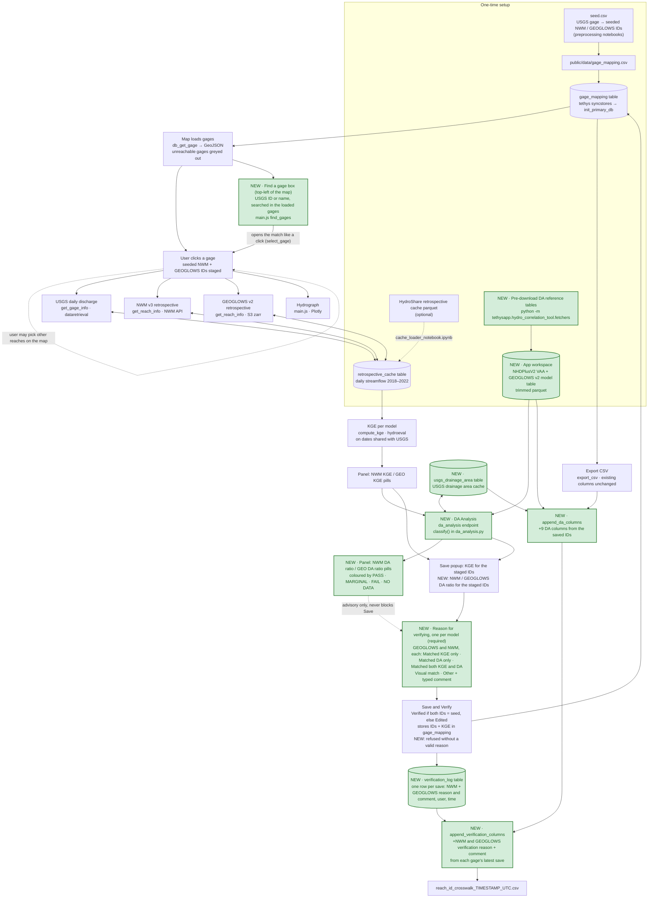

# Methodology

How the Hydro Correlation Tool works, from the seeded IDs to the exported crosswalk CSV. **Keep this file up to date with every change to the app** and add a line to the [change log](#change-log).

Green boxes marked **NEW** were added on the `add-DA-Analysis` branch (DA Analysis and the Save and Verify reason, 2026-10-20; gage search, 2026-10-23).



## Steps

| Step | Where | Reads | Writes |
|---|---|---|---|
| Seed | `preprocessing/` notebooks | USGS site list, NHDPlus/GEOGLOWS hydrography | `seed.csv`, `gage_mapping.csv` |
| Load table | `model.py` `init_primary_db` (via `tethys syncstores`) | `gage_mapping.csv` | `gage_mapping` |
| Load cache (optional) | `preprocessing/cache_loader_notebook.ipynb` | HydroShare parquet | `retrospective_cache` |
| **NEW** Pre-download DA tables | `fetchers.py` `ensure_da_reference_tables` | NHDPlusV2 VAA, GEOGLOWS v2 model table | App workspace `da_reference/` |
| Map | `controllers.py` `db_get_gage`, `main.js` | `gage_mapping`, `unreachable_gages.csv` | — |
| **NEW** Find a gage | `main.js` gage search control (`find_gages`, `open_search_match`), `main.css` | Gage features already loaded for the map | — (opens the gage with `select_gage`) |
| Fetch series | `controllers.py` `get_gage_info` / `get_reach_info`, `fetchers.py` | Cache first, then USGS / NWM API / GEOGLOWS S3 | `retrospective_cache` (temporary errors are not cached) |
| KGE | `controllers.py` `compute_kge` | `retrospective_cache` | — (recalculated every time) |
| **NEW** DA Analysis | `controllers.py` `da_analysis`, `da_analysis.py`, `main.js` `display_da` | `usgs_drainage_area` (USGS API on a miss), DA reference tables | `usgs_drainage_area` |
| Save and Verify | `controllers.py` `save_and_verify`, **NEW** NWM and GEOGLOWS reason dropdowns in the Save popup (`home.html`, `main.js`) | Staged IDs, KGE, **NEW** reason + comment per model | `gage_mapping`, **NEW** `verification_log` (same transaction) |
| Export | `controllers.py` `export_csv` (+ **NEW** `append_da_columns`, `append_verification_columns`) | `gage_mapping`, DA sources, `verification_log` | CSV download |

## DA Analysis (new)

An advisory check that the gage's drainage area fits the drainage area of the chosen NWM and GEOGLOWS reaches. It never blocks Save and Verify.

**Drainage areas (all in km²)**

| Model | Upstream end (US) | Downstream end (DS) | Source |
|---|---|---|---|
| USGS | — | `drainage_area` × 2.58999 (sq mi → km²) | `dataretrieval.waterdata.get_monitoring_locations` (dataretrieval 1.3.0) |
| NWM v3 (feature_id = NHDPlusV2 COMID) | `TotDASqKM − AreaSqKM` | `TotDASqKM` | NHDPlusV2 value-added attributes, `nhdplusVAA.parquet` from HydroShare resource [`6092c8a62fac45be97a09bfd0b0bf726`](https://www.hydroshare.org/resource/6092c8a62fac45be97a09bfd0b0bf726/) (the file `pynhd.nhdplus_vaa()` reads; 2,691,339 COMIDs; 257,747,436 bytes, downloaded 2026-10-20) |
| GEOGLOWS v2 (river_id = LINKNO) | `USContArea` × 1e-6 | `DSContArea` × 1e-6 | GEOGLOWS v2 model table, `https://geoglows-v2.s3-us-west-2.amazonaws.com/tables/v2-model-table.parquet` (the file `geoglows.data.metadata_table()` reads; 6,838,900 rivers; 245,506,513 bytes, downloaded 2026-10-20) |

NHDPlus rounding can make `TotDASqKM − AreaSqKM` slightly negative on a headwater reach. Values between −0.01 and 0 km² are treated as US = 0.

**NHDPlusV2 field definitions** (McKay et al., 2012). The PlusFlowlineVAA table points `AreaSqKm` to the Catchment table and `TotDASqKm` / `DivDASqKm` to the CumulativeArea table (pp. 52–53). They are defined as:

- `AreaSqKm`: *"Catchment area in square kilometers"* (Catchment feature class, p. 47). The catchment's FeatureID equals the flowline's ComID, so this is that one reach's local catchment, without anything upstream.
- `TotDASqKm`: *"Total Upstream Cumulative Drainage Area, in square kilometers, at the downstream end of the NHDFlowline feature"* (CumulativeArea table, p. 47).
- `DivDASqKm`: *"Divergence-routed Cumulative Drainage Area, in square kilometers, at the downstream end of the NHDFlowline feature"* (same table). Not used here.

So `TotDASqKM` is the drainage area at the downstream end of the reach (DS), and subtracting the reach's own catchment gives the area at its upstream end (US). The guide does not state this subtraction itself; it follows from the two definitions. It holds wherever streams only join; at divergences (where a river splits) `TotDASqKM` is not simply upstream total + local catchment, which is why a clearly negative US is reported as NO DATA.

> McKay, L., Bondelid, T., Dewald, T., Johnston, J., Moore, R., and Rea, A. (2012). *NHDPlus Version 2: User Guide* (Data Model Version 2.1, updated March 13, 2019). U.S. Environmental Protection Agency. pp. 47, 52–53. https://www.epa.gov/system/files/documents/2023-04/NHDPlusV2_User_Guide.pdf

**Classification** (`da_analysis.py`, t = `DA_TOLERANCE` = 0.10)

```
ratio    = DS / USGS_DA
PASS     if US*(1-t)  <= USGS_DA <= DS*(1+t)
MARGINAL if not PASS and US*(1-2t) <= USGS_DA <= DS*(1+2t)
FAIL     otherwise
NO DATA  if USGS_DA, US or DS is missing or <= 0 (headwater reach: US = 0 is allowed)
```

The panel shows one pill per model, `NWM DA ratio: 0.94` / `GEO DA ratio: 1.04`, coloured by class with the KGE colours: PASS green, MARGINAL dark gold, FAIL red, NO DATA grey and dashed (ratio shown as N/A). The class word appears in the pill's tooltip. The drainage areas themselves are in the export CSV.

The Save and Verify popup also shows `GEOGLOWS DA ratio` / `NWM DA ratio` under its KGE lines, as coloured text in the same style, for the **staged** IDs about to be saved. It loads in parallel with KGE when the popup opens and never affects the Save button.

**GEOGLOWS units check.** The GEOGLOWS v2 docs don't give units for `USContArea`/`DSContArea`. The raw values divided by the USGS drainage area in km² came out at about 1,000,000 at four large gages, so the values are in **m²**:

| Gage | USGS DA (km²) | GEOGLOWS river | Raw `DSContArea` | Raw ÷ USGS km² | GEO DS (km²) | NWM DS (km²) |
|---|---|---|---|---|---|---|
| 06934500 Missouri R. at Hermann, MO | 1,353,270 | 760733072 | 1,408,794,099,712 | 1,041,030 | 1,408,794 | 1,277,918 |
| 07289000 Mississippi R. at Vicksburg, MS | 2,964,244 | 760114552 | 2,985,589,473,280 | 1,007,201 | 2,985,589 | 2,860,293 |
| 14105700 Columbia R. at The Dalles, OR | 613,828 | 720199910 | 554,973,462,528 | 904,119 | 554,973 | 569,780 |
| 03612600 Ohio R. at Olmsted, IL | 525,768 | 760704900 | 513,142,095,872 | 975,986 | 513,142 | 524,135 |

**Caching.** USGS drainage areas are cached in the `usgs_drainage_area` table on first use; temporary errors are retried later, the same rule as `retrospective_cache`. The two reference tables are downloaded once into the app workspace (`workspaces/app_workspace/da_reference/`, git-ignored; `HCT_DA_CACHE_DIR` overrides it). Only the three needed columns are kept, sorted by ID, so a lookup reads a small piece of the file instead of loading it into memory. If the tables aren't downloaded yet, the panel starts the download in the background and shows NO DATA until it finishes, while the export waits for the download.

**Export.** All existing columns stay in the same order; these are appended, computed from the IDs saved on each row:
`usgs_da_km2, nwm_da_us_km2, nwm_da_ds_km2, nwm_da_ratio, nwm_da_class, geoglows_da_us_km2, geoglows_da_ds_km2, geoglows_da_ratio, geoglows_da_class`

## Find a gage (new)

A search box over the top-left of the map, to the right of the zoom buttons and the basemap (layers) button. It searches the ~9,100 gages that are already loaded for the map, so it sends no request to the server.

- **By ID:** `06934500`, `USGS-06934500` and `usgs 06934500` are the same search. Part of an ID also works (`069345`). Exact matches come first, then IDs that start with the digits, then IDs that contain them.
- **By name:** every typed word must start a word of the gage name, upper or lower case (`missouri river at` finds "Missouri River at Hermann" but not "... near Great Falls"). Names that start with the first word come first.
- Up to 10 matches are listed, each with a dot in its status colour. Click one, or use the arrow keys and **Enter** (Enter alone takes the top match). **Esc** closes the list.
- The chosen gage opens through `select_gage`, exactly like clicking its dot: the map flies to it and the panel, hydrograph, KGE and DA load as usual. If that status is hidden by the legend filter, the gage still opens and a note says its dot is not drawn.

## Verification reason (new)

The NWM and GEOGLOWS reaches are judged separately, so the Save popup asks for a reason **for each model**: a "Reason for verifying GEOGLOWS" and a "Reason for verifying NWM" dropdown (in the same order as the popup's KGE and DA lines). Both are **required** before **Save and verify** can be clicked. The choices are in `model.py` `VERIFICATION_REASONS`, which `home.html` uses to draw both dropdowns, so the dropdowns and the server check always match:

- Matched KGE only
- Matched DA only
- Matched both KGE and DA
- Visual match (map location / hydrograph)
- Other: a text box appears under that model's dropdown and must be filled in (up to 500 characters)

The button stays disabled until KGE has loaded **and** both models have a valid reason. The server checks each model's reason again (`clean_verification_reason`, once per model) and refuses the save if either is missing. A comment is kept only where that model's reason is "Other". A `verification_log` left by the earlier single-reason version (one required `reason`/`comment`) is upgraded the first time it is used: `upgrade_verification_log_table` adds the four per-model columns and makes the old `reason` optional, keeping old rows unchanged. Each save adds a row to `verification_log` (usgs_id, saved IDs, status, `nwm_reason`, `nwm_comment`, `geoglows_reason`, `geoglows_comment`, username, timestamp) in the same transaction as the `gage_mapping` update, so a re-verified gage keeps its full history. The export appends `nwm_verification_reason`, `nwm_verification_comment`, `geoglows_verification_reason` and `geoglows_verification_comment` from each gage's **latest** save; gages not saved since this feature was added are blank.

## Change log

| Date | Change | Diagram steps |
|---|---|---|
| 2026-10-20 | Added DA Analysis: drainage-area check under the KGE pills and 9 DA columns in the export CSV | Pre-download DA tables, App workspace, DA Analysis, usgs_drainage_area, DA pills, append_da_columns |
| 2026-10-20 | DA pills now show the ratio value (coloured by class) instead of the class word; the USGS/US/DS detail lines under the pills were removed | DA pills |
| 2026-10-20 | Added a required reason for verifying (dropdown + "Other" text) to the Save popup, logged in `verification_log` and exported as 2 columns | Reason for verifying, Save and Verify, verification_log, append_verification_columns |
| 2026-10-21 | DA ratios (NWM and GEOGLOWS) also shown in the Save and Verify popup, for the staged IDs | Save popup |
| 2026-10-23 | The verification reason is now asked per model (NWM and GEOGLOWS): two required dropdowns, 4 reason/comment columns in `verification_log` and in the export | Reason for verifying, verification_log, append_verification_columns |
| 2026-10-23 | `verification_log` created by the single-reason version is upgraded on first use (`upgrade_verification_log_table`): the 4 per-model columns are added and the old `reason` becomes optional; old rows are kept | verification_log |
| 2026-10-23 | Added a "Find a gage" search box (USGS ID or name) over the top-left of the map | Find a gage |
| 2026-10-23 | Documentation only: added the NHDPlusV2 User Guide definitions of `AreaSqKm` / `TotDASqKm` and the citation behind the NWM US/DS formula | — |
